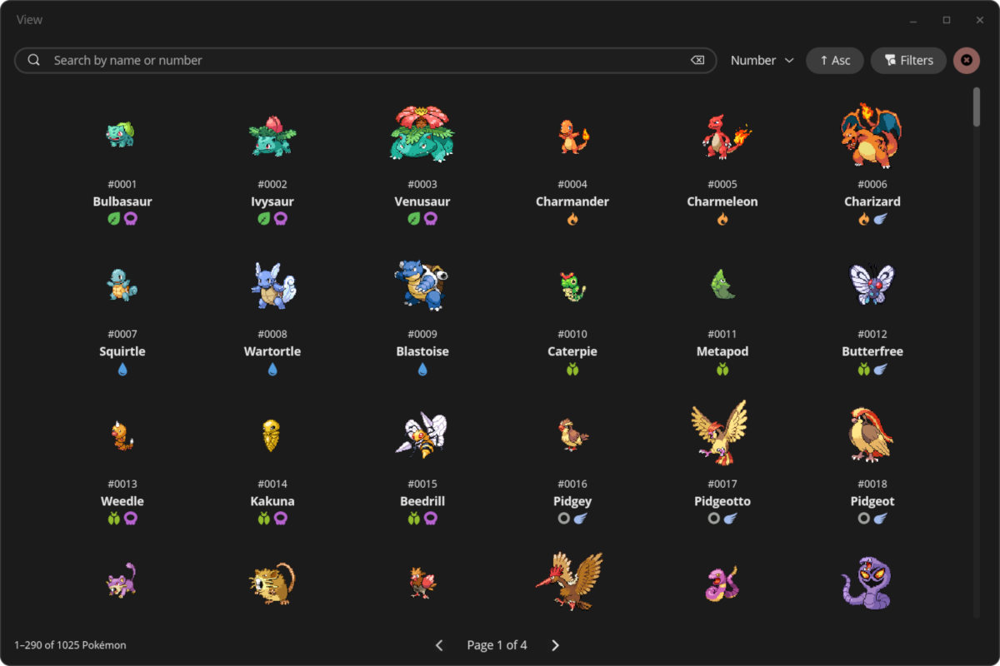
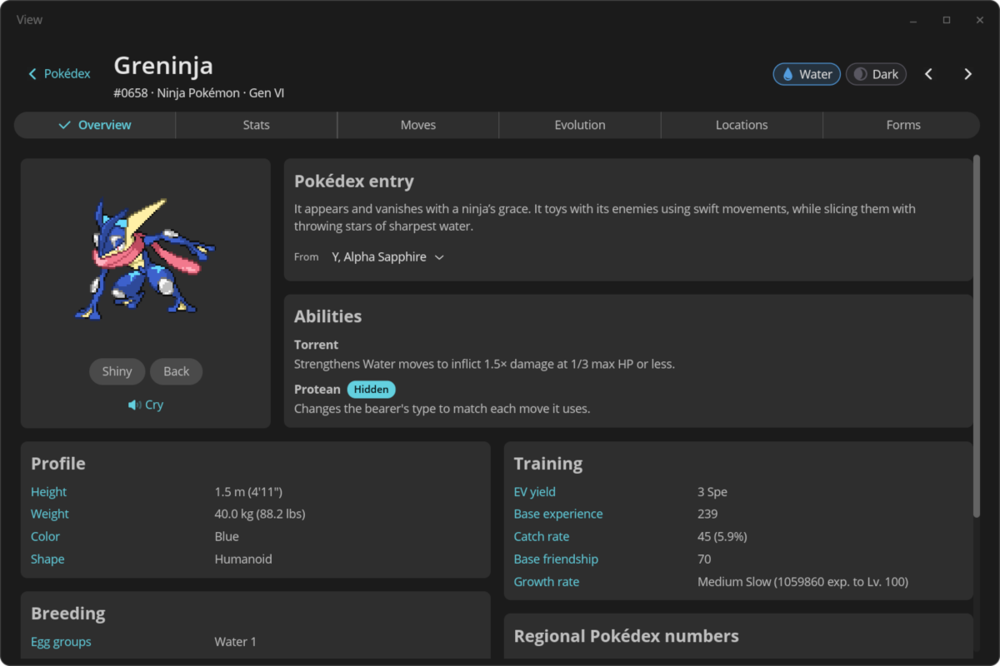

<div align="center">
<br>

<h1 align="center">StarryDex</h1>


<h3>A Pokédex application for the COSMIC™ desktop</h3>




<br><br>

<a href="https://flathub.org/apps/dev.mariinkys.StarryDex">
   
 </a>
 </div>

## Install

To install your COSMIC application, you will need [just](https://github.com/casey/just), if you're on Pop!\_OS, you can install it with the following command:

```sh
sudo apt install just
```

After you install it, you can run the following commands to build and install your application:

```sh
just build-release
sudo just install
```

## Attribution

> "[Pop Icons](http://github.com/pop-os/icon-theme)" by [System76](http://system76.com/) is licensed under [CC-SA-4.0](http://creativecommons.org/licenses/by-sa/4.0/)

> "Pokémon Type Icons" originally made by [duiker101](https://github.com/duiker101/pokemon-type-svg-icons)

Pokémon and Pokémon character names are trademarks of Nintendo.

This application uses [PokeApi](https://github.com/PokeAPI/) and its resources.

## Development

The workspace has three crates:

- `starrydex` — the COSMIC app
- `assetgen` — downloads PokéAPI data and builds the bundled assets
- `model` (`starrydex-model`) — the data model shared by both. `assetgen` writes it as an
  [rkyv](https://rkyv.org) archive and the app memory-maps that archive and reads it in place,
  so the whole Pokédex never has to be deserialized into RAM.

To update/generate the assets run:

```sh
cargo run --release -p assetgen -- -a
```

```
-a                 All assets (default): data, sprites and cries
-p                 Only Pokémon data      -> assets/pokedex.bin.gz
-s                 Only sprites           -> assets/sprites.tar.gz
-c                 Only cries             -> assets/cries.tar.gz
--base-url <URL>   PokéAPI to use (default https://pokeapi.co/api/v2/)
--concurrency <N>  Parallel requests (default 16)
```

The data records which sprites and cries exist, so prefer regenerating everything together with `-a`.
A full run makes roughly 10,000 API requests; pointing `--base-url` at a
[self-hosted PokéAPI](https://github.com/PokeAPI/pokeapi#docker-and-compose-) is much faster and
spares the public servers.

If you change any type in `model/`, bump `FORMAT_VERSION` there and `CACHE_VERSION` in
`src/app/core.rs`, then regenerate the assets.

### Dependencies

All of [libcosmic dependencies](https://github.com/pop-os/libcosmic?tab=readme-ov-file#dependencies) and
- GStreamer 1.0 with plugins (base)

## Copyright and Licensing

Copyright 2024 © Alex Marín

Released under the terms of the [GPL-3.0](./LICENSE)
